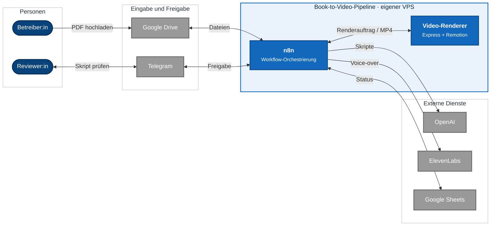
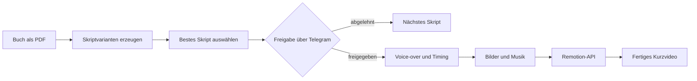
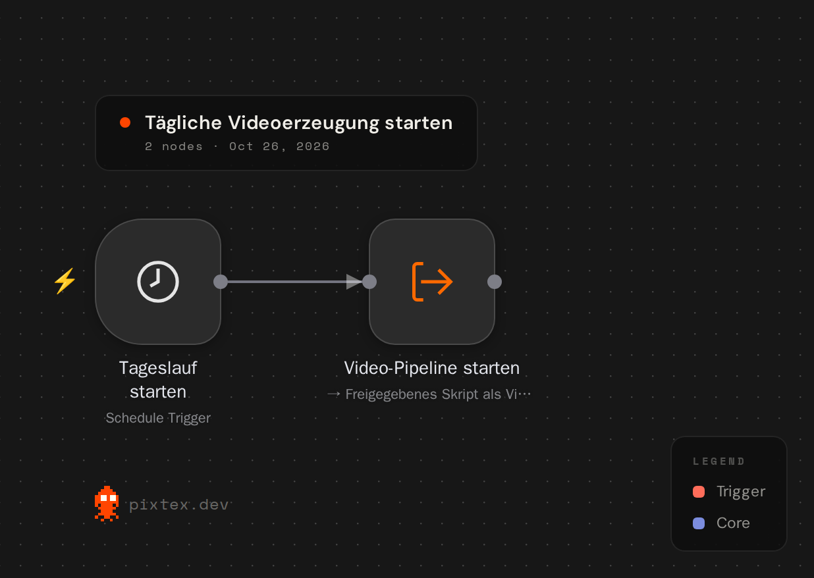
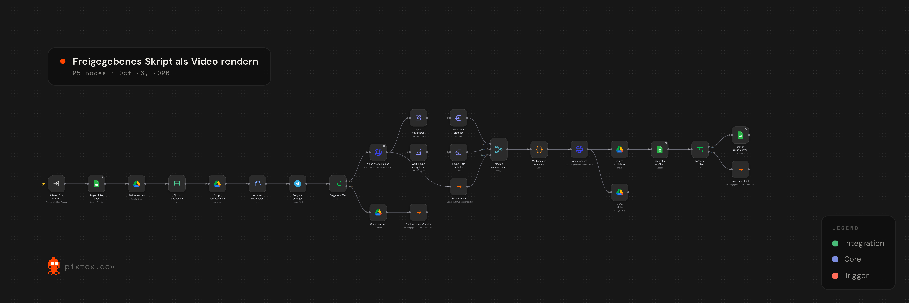
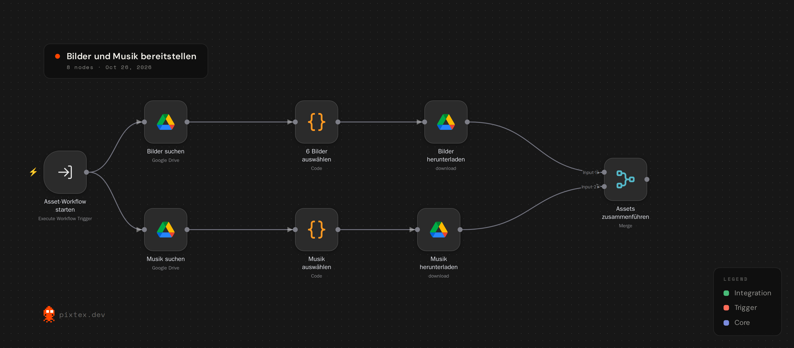
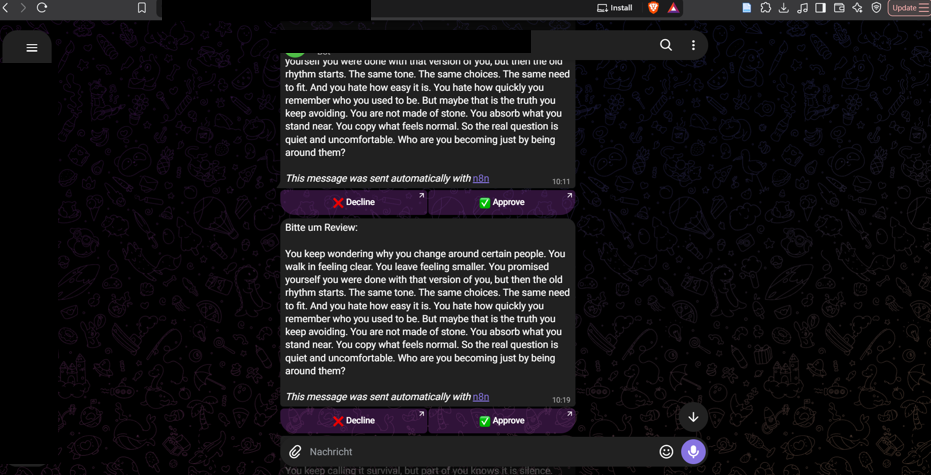

# Automatisierte Book-to-Video-Pipeline

> 🎬 **[Erzeugte Videos auf TikTok ansehen: @abyss_echos](https://www.tiktok.com/@abyss_echos)**
>
> **Projektstatus:** Die Pipeline befindet sich in kontinuierlicher Weiterentwicklung und Verbesserung. Workflows, Videoqualität, Zuverlässigkeit und Fehlerbehandlung werden regelmäßig überarbeitet.

Dieses Projekt verwandelt Buchinhalte automatisiert in vertikale Kurzvideos. **n8n** steuert den gesamten Ablauf – von der Verarbeitung eines hochgeladenen Buchs bis zur menschlichen Freigabe – und übergibt anschließend alle Medien an eine eigene **Remotion-API**, die das fertige Video rendert.

Die produktive Lösung läuft selbst gehostet auf einem VPS. Dieses Repository enthält eine bereinigte Portfolio-Version ohne Zugangsdaten, personenbezogene Daten oder interne Ressourcen-IDs.

## n8n-Automatisierung

### Systemarchitektur



### Konzeptionelles Ablaufdiagramm



### Ablauf

1. Ein Google-Drive-Trigger erkennt ein neu hochgeladenes Buch.
2. n8n extrahiert den Text, teilt ihn in Abschnitte und erstellt mehrere Skriptvarianten.
3. Ein separates Reviewer-Modell bewertet die Varianten und wählt die stärkste aus.
4. Ein täglicher Workflow lädt das nächste Skript und fordert über Telegram eine manuelle Freigabe an.
5. Nach der Freigabe erzeugt ElevenLabs das Voice-over inklusive zeitlicher Wortausrichtung.
6. Bilder und Hintergrundmusik werden ausgewählt und zusammen mit dem Transkript an die Remotion-API gesendet.
7. Die API rendert das vertikale MP4-Video.

### Workflow-Einblicke

#### Buch nach dem Upload verarbeiten


#### Tägliche Videoerzeugung starten



#### Freigegebenes Skript als Video rendern



#### Bilder und Musik bereitstellen



#### Human-in-the-Loop über Telegram



### Enthaltene Workflows

| Workflow | Aufgabe |
| --- | --- |
| [`01-process-book-after-upload.json`](n8n/workflows/01-process-book-after-upload.json) | Extrahiert den Buchtext, erzeugt und bewertet Skripte und speichert die Auswahl. |
| [`02-generate-video-schedule.json`](n8n/workflows/02-generate-video-schedule.json) | Startet die Videoerzeugung täglich um 17 Uhr in der Zeitzone der n8n-Instanz. |
| [`03-generate-video-subworkflow.json`](n8n/workflows/03-generate-video-subworkflow.json) | Orchestriert Auswahl, Freigabe, Voice-over, Rendering und Fortschrittsverwaltung. |
| [`04-download-assets.json`](n8n/workflows/04-download-assets.json) | Wählt Bilder und Musik aus Google Drive aus und lädt sie für das Rendering herunter. |

Die Exporte sind absichtlich deaktiviert. Credential-Verknüpfungen und konkrete IDs wurden entfernt. Weitere Details stehen in der [n8n-Dokumentation](n8n/README.md).

## Remotion-Renderer

Der Renderer stellt einen HTTP-Endpunkt unter `POST /video` bereit. n8n sendet folgende Daten als `multipart/form-data`:

| Feld | Inhalt |
| --- | --- |
| `voice_over` | generierte Sprachaufnahme |
| `transcription` | ElevenLabs-Transkript mit Zeitstempeln |
| `images` | mehrere Hintergrundbilder |
| `background_music` | Hintergrundmusik |

Das Ergebnis ist ein vertikales MP4-Video mit synchronisierten Untertiteln, Bildwechseln, Voice-over und Hintergrundmusik. Die vollständige API-Beschreibung befindet sich in der [Remotion-Dokumentation](remotion/README.md).

## Technologien

- n8n für Orchestrierung, Trigger und Subworkflows
- OpenAI über n8n LangChain Nodes für Skripterstellung und Bewertung
- Google Drive und Google Sheets für Dateien und Verarbeitungsstatus
- Telegram für die manuelle Freigabe
- ElevenLabs für Sprachsynthese und Wort-Timing
- React, TypeScript und Remotion für das Video-Rendering
- Express und Multer für die Rendering-API
- Docker und VPS für den Betrieb

## Lokal starten

Voraussetzungen: Node.js und npm.

```bash
cd remotion
npm install
node src/api.js
```

Die API ist anschließend unter `http://localhost:3000/video` erreichbar.

Alternativ mit Docker:

```bash
cd remotion
docker build -t tiktok-video-generator .
docker run -p 3000:3000 tiktok-video-generator
```

## Repository-Struktur

```text
.
├── n8n/
│   ├── workflows/       # Bereinigte und deaktivierte n8n-Exporte
│   ├── docs/            # Architektur und Setup
│   └── assets/          # Screenshots der Workflows
└── remotion/
    ├── src/             # Renderer und HTTP-API
    ├── Dockerfile
    └── README.md        # API-Dokumentation
```

## Weiterführende Dokumentation

- [n8n-Projektübersicht](n8n/README.md)
- [Architektur und Datenfluss](n8n/docs/ARCHITEKTUR.md)
- [Import und Konfiguration](n8n/docs/SETUP.md)
- [Remotion-API](remotion/README.md)

## Geplante Verbesserungen

- robustere Filterung nicht relevanter Buchbestandteile
- Retry- und Fehlerworkflows mit Benachrichtigungen
- idempotente Verarbeitung zur Vermeidung doppelter Videos
- persistente Queue anstelle der Statusverwaltung über Google Sheets
- automatisierte Qualitätskontrollen für Videoformat, Dauer und Dateigröße
