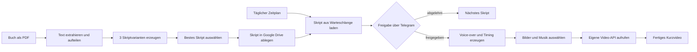

# Automatisierte Book-to-Video-Pipeline mit n8n

Dieses Projekt verwandelt hochgeladene Bücher automatisiert in kurze
Voice-over-Videos. Ein n8n-Workflow extrahiert den Buchtext, zerlegt ihn in
verarbeitbare Abschnitte und erzeugt daraus mehrere Skriptvarianten. Ein zweites
KI-Modell bewertet die Varianten, bevor ein Mensch das ausgewählte Skript über
Telegram freigibt. Anschließend entstehen Voice-over, Transkript, Medienpaket
und das fertige Video.

Die produktive Lösung läuft selbst gehostet auf einem VPS. Dieses Repository
enthält eine bereinigte Portfolio-Version der n8n-Workflows ohne Zugangsdaten,
personenbezogene Daten oder interne Ressourcen-IDs.

## Ablauf



## Zentrale Funktionen

- Verarbeitung neuer PDF-Dateien aus einem überwachten Google-Drive-Ordner
- Aufteilung langer Texte in überlappende Abschnitte
- Erzeugung von drei englischen Voice-over-Skripten pro Abschnitt
- strukturierte Bewertung und Auswahl der stärksten Variante durch ein
  separates Reviewer-Modell
- menschliche Freigabe oder Ablehnung über Telegram
- Sprachsynthese mit ElevenLabs einschließlich zeitlicher Wortausrichtung
- zufällige Auswahl von sechs Hintergrundbildern und einem Musiktitel
- Übergabe aller Binärdateien an eine eigene Video-Rendering-API
- Begrenzung der täglichen Verarbeitung über einen Zähler in Google Sheets

## Workflows

| Workflow | Aufgabe |
| --- | --- |
| [`01-process-book-after-upload.json`](workflows/01-process-book-after-upload.json) | Reagiert auf neue Buchdateien, extrahiert den Text, erzeugt und bewertet Skripte und speichert die Auswahl. |
| [`02-generate-video-schedule.json`](workflows/02-generate-video-schedule.json) | Startet die Videoerzeugung täglich um 17 Uhr in der Zeitzone der n8n-Instanz. |
| [`03-generate-video-subworkflow.json`](workflows/03-generate-video-subworkflow.json) | Orchestriert Auswahl, Freigabe, Voice-over, Rendering und Fortschrittsverwaltung. |
| [`04-download-assets.json`](workflows/04-download-assets.json) | Wählt zufällige Bilder und Musik aus Google Drive und lädt sie für das Rendering herunter. |

Alle Exporte sind absichtlich deaktiviert. Credential-Verknüpfungen und konkrete
IDs wurden entfernt. Hinweise zur erneuten Konfiguration stehen in
[`docs/SETUP.md`](docs/SETUP.md).

## Technischer Aufbau

| Bereich | Technologie / Dienst | Einsatz |
| --- | --- | --- |
| Orchestrierung | n8n, selbst gehostet | Trigger, Verzweigungen, Subworkflows und Datenübergabe |
| Dokumentablage | Google Drive | Eingangsbücher, generierte Skripte, Medien und Ergebnisse |
| Statusverwaltung | Google Sheets | Zähler für die tägliche Verarbeitung |
| Textgenerierung | OpenAI über n8n LangChain Nodes | Erstellung und Bewertung der Skriptvarianten |
| Human in the Loop | Telegram | Manuelle Freigabe vor kostenpflichtiger Medienerzeugung |
| Sprachsynthese | ElevenLabs API | Audio und zeitliche Ausrichtung des gesprochenen Texts |
| Videoerzeugung | Eigene HTTP-API | Rendering aus Audio, Transkript, Musik und Bildern |
| Betrieb | VPS | Hosting der n8n-Instanz und der Video-API |

## Technische Schwerpunkte

- Zerlegung langer Eingaben in 4.000-Zeichen-Blöcke mit 400 Zeichen
  Überlappung
- strukturierte LLM-Ausgaben mit Output Parsern
- Trennung in wiederverwendbare Haupt- und Subworkflows
- Verarbeitung von JSON- und Binärdaten innerhalb derselben Pipeline
- Multipart-Upload mehrerer Medientypen an einen eigenen API-Endpunkt
- bewusster Freigabeschritt vor externen API-Aufrufen und Rendering

## Repository-Struktur

```text
.
├── README.md
├── workflows/               # Bereinigte und deaktivierte n8n-Exporte
├── docs/
│   ├── ARCHITEKTUR.md       # Komponenten und Datenflüsse
│   └── SETUP.md             # Import und erforderliche Konfiguration
└── assets/                  # Platz für Screenshots oder ein Demo-GIF
```

## Dokumentation

- [Architektur und Datenfluss](docs/ARCHITEKTUR.md)
- [Import und Konfiguration](docs/SETUP.md)

## Mögliche Weiterentwicklungen

- Vorwort, Inhaltsverzeichnis und andere nicht relevante Buchteile vor der
  Skripterzeugung filtern
- Fehlerworkflow mit Wiederholungsstrategie und Benachrichtigungen ergänzen
- Verarbeitung idempotent machen, damit ein erneuter Lauf keine doppelten
  Videos erzeugt
- Statusverwaltung von Google Sheets in eine robuste persistente Queue
  überführen
- automatisierte Qualitätskontrollen für Videoformat, Dauer und Dateigröße

