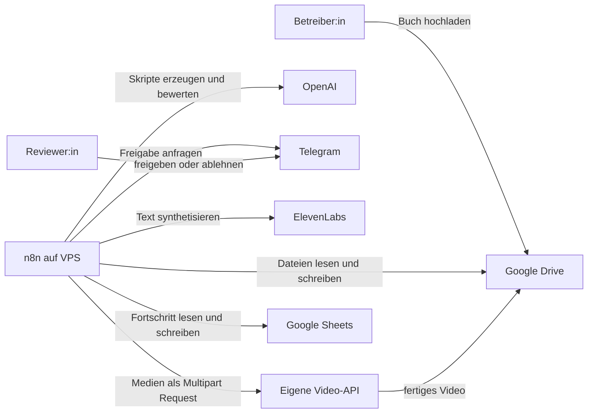
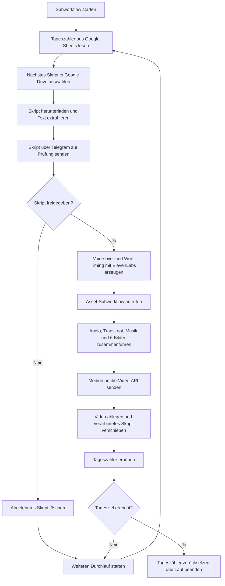

# Architektur

## 1. Ziel und Systemgrenze

Die Automation erstellt aus langen Buchtexten kurze, freigegebene
Voice-over-Videos. n8n übernimmt die Orchestrierung und verbindet Dateispeicher,
Sprachmodelle, einen menschlichen Review-Schritt, Sprachsynthese und eine eigene
Video-API.

Das Repository dokumentiert die Workflow-Logik. Die Konfiguration des VPS, die
n8n-Datenbank, Zugangsdaten und die Implementierung der Video-API sind nicht
Bestandteil des Exports.

## 2. Systemkontext

## 3. Workflow-Bausteine

### 3.1 Buchverarbeitung

`Buch nach Upload in Skripte umwandeln` überwacht einen Google-Drive-Ordner im
Minutentakt. Bei einer neuen Datei führt der Workflow folgende Schritte aus:

1. Dateinamen normalisieren und die Datei herunterladen.
2. Text aus der Datei extrahieren.
3. Text in Abschnitte mit 4.000 Zeichen und 400 Zeichen Überlappung teilen.
4. Für jeden Abschnitt drei Voice-over-Skripte erzeugen.
5. Die Varianten nach emotionaler Wirkung, Natürlichkeit, Stil, Originalität
   und Rhythmus bewerten lassen.
6. Das ausgewählte Skript als Textdatei in Google Drive speichern.

Die Skripterstellung und die anschließende Bewertung verwenden getrennte
OpenAI-Modell-Nodes.

### 3.2 Zeitgesteuerter Start

`Tägliche Videoerzeugung starten` startet täglich um 17 Uhr. Die tatsächliche Uhrzeit
richtet sich nach der Zeitzone der n8n-Instanz. Der Workflow delegiert die
Verarbeitung an den Video-Subworkflow.

### 3.3 Freigabe und Videoerzeugung

Der Subworkflow `Freigegebenes Skript als Video rendern` verarbeitet jeweils ein vorbereitetes Skript.
Er wählt das Skript selbst aus Google Drive aus; vom Scheduler wird lediglich
das Startsignal übergeben.

Der **Tageszähler** ist der Wert `Uploads` im Google Sheet `Upload_Tracker`. Er
merkt sich, wie viele freigegebene Videos im aktuellen Tageslauf erfolgreich
verarbeitet wurden. Nach jedem fertiggestellten Video erhöht der Workflow den
Wert. Anhand dieses Zählers entscheidet er, ob er ein weiteres Skript laden oder
den Lauf beenden soll, damit der Reviewer nicht pro Tag viele Skripte reviewen muss. Zum Abschluss wird der Zähler für den nächsten
Zeitplanlauf wieder auf `0` gesetzt. Abgelehnte Skripte erhöhen den Zähler nicht,
da für sie kein Video erzeugt wird.

Der Ablauf besteht damit aus fünf klaren Phasen:

| Phase | Verarbeitung | Ergebnis |
| --- | --- | --- |
| Auswahl | Zähler lesen und nächstes Skript aus Google Drive laden | Text eines noch nicht verarbeiteten Skripts |
| Freigabe | Skript an Telegram senden und auf eine Entscheidung warten | Freigabe oder Ablehnung durch einen Menschen |
| Medienerzeugung | Voice-over und Wort-Timing erzeugen sowie Bilder und Musik laden | vollständiges Medienpaket für ein Video |
| Rendering | Medien als Multipart Request an die eigene Video-API senden | gerendertes Kurzvideo |
| Abschluss | Skript verschieben, Ergebnis ablegen und Zähler aktualisieren | abgeschlossene Verarbeitung oder nächster Durchlauf |

Bei einer Ablehnung wird kein Video erzeugt. Der Workflow entfernt das Skript
aus der Warteschlange und prüft das nächste. Erst nach einer Freigabe ruft er
ElevenLabs, den Asset-Subworkflow und die Video-API auf.

### 3.4 Medienauswahl

`Bilder und Musik bereitstellen` durchsucht zwei Google-Drive-Bereiche. Die
verfügbaren Dateien werden mit Fisher-Yates gemischt. Der Workflow wählt sechs
Bilder und einen Musiktitel aus, lädt die Binärdaten herunter und führt beide
Zweige wieder zusammen.

## 4. Datenübergabe an die Video-API

Vor dem HTTP-Aufruf konsolidiert n8n alle Binärdaten in einem Objekt. Die
Video-API erhält einen `multipart/form-data` Request mit folgendem Vertrag:

| Feld | Inhalt |
| --- | --- |
| `voice_over` | MP3-Datei des gesprochenen Skripts |
| `transcription` | JSON-Datei mit normaler und normalisierter Wortausrichtung |
| `background_music` | ausgewählter Musiktitel |
| `images` | sechs wiederholte Multipart-Felder mit Hintergrundbildern |

## 5. Zuständigkeiten

| Komponente | Verantwortung |
| --- | --- |
| n8n | Ablaufsteuerung, Transformation, Verzweigungen und Übergabe der Daten |
| Google Drive | Dateiablage und einfache Warteschlange für Skripte und Medien |
| Google Sheets | Tageszähler für die begrenzte Verarbeitung |
| OpenAI | Erzeugung und Bewertung der Skriptvarianten |
| Telegram | Menschliche Qualitätskontrolle |
| ElevenLabs | Sprachdatei und zeitliche Textausrichtung |
| Video-API | Zusammenführung der Medien zum fertigen Video |

## 6. Portfolio-Export

Die Dateien unter `workflows/` sind öffentliche Demonstrationsartefakte. Sie
sind deaktiviert und enthalten keine Credential-Verknüpfungen, gepinnten Daten,
internen Ressourcen-IDs oder konkreten Chat- und Voice-IDs. Für eine erneute
Ausführung müssen die Platzhalter gemäß [SETUP.md](SETUP.md) konfiguriert werden.

