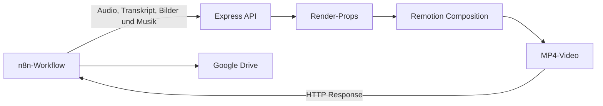

# Remotion Video-Renderer

Der Remotion-Teil dieses Projekts erzeugt aus Voice-over, Transkript, Bildern
und Hintergrundmusik ein fertiges vertikales Kurzvideo. Er läuft als eigener
HTTP-Dienst und wird von der [n8n-Pipeline](../n8n/README.md) aufgerufen, sobald
ein Skript über Telegram freigegeben wurde.

> 🎬 Beispiele der erzeugten Videos sind auf
> **[TikTok unter @abyss_echos](https://www.tiktok.com/@abyss_echos)** zu sehen.

## Funktionsumfang

- HTTP-Endpunkt für komplette Renderaufträge
- vertikales Videoformat mit 1080 × 1920 Pixeln und 30 FPS
- dynamische Videolänge anhand des ElevenLabs-Transkripts
- wortgenaue, animierte Untertitel
- automatische Bildwechsel mit Überblendung und Ken-Burns-Effekt
- Voice-over und Hintergrundmusik mit getrennten Lautstärken
- automatische Bereinigung temporärer Dateien
- Betrieb lokal oder als Docker-Container

## Ablauf



## Schnellstart

Voraussetzungen sind Node.js, npm und ausreichend Ressourcen für das
Chromium-basierte Rendering.

```bash
cd remotion
npm ci
npx remotion browser ensure
node src/api.js
```

Die API ist anschließend unter `http://localhost:3000/video` erreichbar.

Ein einfacher Testaufruf:

```bash
curl \
  -F "voice_over=@voice.mp3" \
  -F "transcription=@transcript.json" \
  -F "images=@image-01.jpg" \
  -F "images=@image-02.jpg" \
  -F "background_music=@music.mp3" \
  http://localhost:3000/video \
  --output video.mp4
```

## Projektstruktur

```text
remotion/
├── docs/
│   ├── ARCHITEKTUR.md     # Komponenten, Renderablauf und Videoaufbau
│   ├── API.md             # HTTP-Vertrag und Transkriptformat
│   └── SETUP.md           # Lokale Einrichtung, Docker und n8n-Anbindung
├── src/
│   ├── api.js             # Express-Endpunkt und Rendersteuerung
│   ├── Root.tsx           # Composition und dynamische Metadaten
│   ├── TikTokVideo.tsx    # Layout, Animationen, Untertitel und Audio
│   └── index.ts           # Registrierung der Remotion-Anwendung
├── Dockerfile
├── package.json
└── remotion.config.ts
```

## Dokumentation

- [Architektur und Renderablauf](docs/ARCHITEKTUR.md)
- [HTTP-API und Datenformate](docs/API.md)
- [Installation und Betrieb](docs/SETUP.md)
- [Architektur der vollständigen n8n-Pipeline](../n8n/docs/ARCHITEKTUR.md)

## Entwicklungsstatus

Der Renderer wird fortlaufend verbessert. Aktuell ist er für den internen
Aufruf durch n8n in einer kontrollierten VPS- beziehungsweise Docker-Umgebung
ausgelegt. Geplante Erweiterungen sind unter anderem Authentifizierung,
Upload-Limits, eine Render-Warteschlange und automatisierte Tests.
