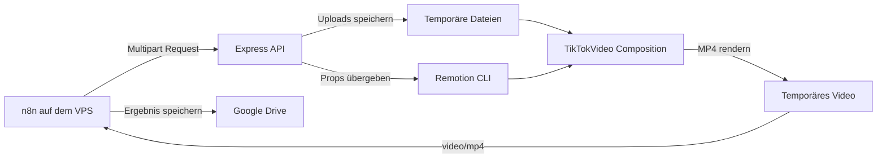
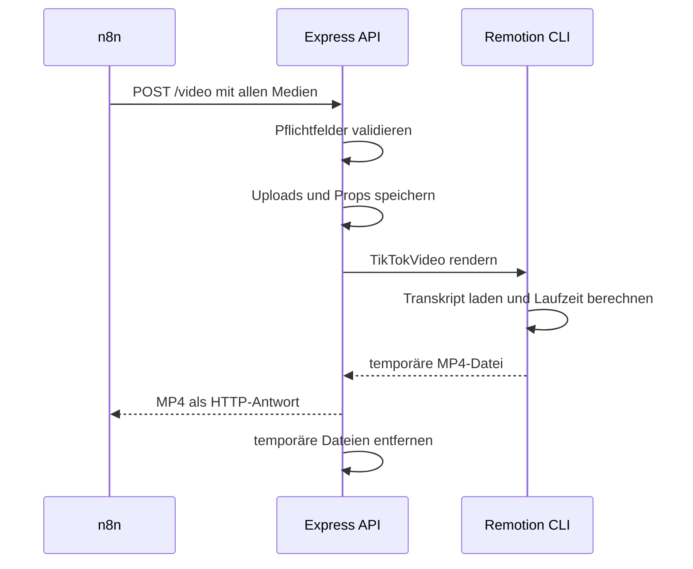

# Architektur des Remotion-Renderers

## 1. Ziel und Systemgrenze

Der Renderer setzt die von n8n vorbereiteten Medien zu einem vertikalen
Kurzvideo zusammen. n8n bleibt für Skripterstellung, Freigabe,
Sprachsynthese, Medienauswahl und Ablage des Ergebnisses verantwortlich.

Der Remotion-Dienst übernimmt ausschließlich:

- Entgegennahme und Prüfung der Renderdaten
- temporäre Speicherung der Medien
- Berechnung von Videolänge und Composition-Props
- frameweises Rendering des Videos
- Rückgabe der MP4-Datei und anschließende Bereinigung

## 2. Systemkontext

## 3. Komponenten

| Komponente | Verantwortung |
| --- | --- |
| `src/api.js` | Express-Server, Multipart-Upload, Validierung, Aufruf der Remotion CLI und Bereinigung |
| `src/index.ts` | Registrierung der Remotion-Anwendung |
| `src/Root.tsx` | Definition der Composition, Laden des Transkripts und Berechnung der Laufzeit |
| `src/TikTokVideo.tsx` | Darstellung von Bildern, Untertiteln, Animationen und Audio |
| Multer | temporäre Speicherung hochgeladener Dateien |
| Remotion CLI | Chromium-basiertes Rendering der Composition als MP4 |

## 4. Ablauf eines Renderauftrags

Der Ablauf besteht aus fünf Phasen:

| Phase | Verarbeitung | Ergebnis |
| --- | --- | --- |
| Upload | Multer speichert Voice-over, Transkript, Bilder und Musik | Dateien unter `public/uploads/` |
| Validierung | API prüft alle Pflichtfelder | vollständiger oder abgelehnter Request |
| Vorbereitung | relative Asset-Pfade werden als JSON-Props gespeichert | Datei unter `.render-props/` |
| Rendering | Remotion CLI rendert die Composition `TikTokVideo` | MP4 im System-Tempordner |
| Antwort | Express sendet das Video und löscht temporäre Daten | MP4-Response an n8n |

Jeder Request erhält eine eigene ID. Sie verbindet die Logeinträge für Upload,
Renderstart, Renderende, Dateiübertragung und Bereinigung.

## 5. Dynamische Composition

Die Composition ist auf 1080 × 1920 Pixel und 30 FPS festgelegt. Ihre Laufzeit
wird für jeden Auftrag neu berechnet:

1. `Root.tsx` lädt das übergebene ElevenLabs-Transkript.
2. Wenn vorhanden, wird `normalized_alignment` verwendet, andernfalls
   `alignment`.
3. Der letzte gültige Wert aus `character_end_times_seconds` bestimmt das Ende
   des gesprochenen Texts.
4. Die Laufzeit wird in Frames umgerechnet und um eine Sekunde Nachlauf ergänzt.
5. Die relativen Asset-Pfade werden mit `staticFile()` für Remotion aufgelöst.

Damit endet das Video nicht unmittelbar mit dem letzten gesprochenen Zeichen
und muss nicht auf eine feste Dauer begrenzt werden.

## 6. Visueller Aufbau

| Eigenschaft | Standardverhalten |
| --- | --- |
| Auflösung | 1080 × 1920 Pixel, Seitenverhältnis 9:16 |
| Bildrate | 30 FPS |
| Bilddauer | 90 Frames beziehungsweise 3 Sekunden |
| Übergang | 18 Frames lange Überblendung |
| Bildbewegung | leichter Zoom und wechselnde Drift im Ken-Burns-Stil |
| Overlay | schwarze Ebene mit Deckkraft `0.4` und zusätzliche Vignette |
| Untertitel | jeweils das aktuell gesprochene Wort in der Bildmitte |
| Voice-over | Lautstärke `1.0` |
| Musik | Lautstärke `0.2` |

### 6.1 Bildwechsel

Die Bilder werden zyklisch verwendet und mit `object-fit: cover` auf die
gesamte Fläche skaliert. Beim Wechsel werden vorheriges und aktuelles Bild
überlagert und weich überblendet. Zoom und Bewegungsrichtung werden
deterministisch aus dem Bildindex abgeleitet.

### 6.2 Wortgenaue Untertitel

Das ElevenLabs-Transkript liefert Zeitstempel für einzelne Zeichen. Pro Frame
wird das aktive Zeichen gesucht und bis zu den angrenzenden Leerzeichen zum
vollständigen Wort erweitert. Das Wort erscheint mit Einblendung, Skalierung,
vertikaler Bewegung und abnehmender Unschärfe.

## 7. Temporäre Dateien

| Pfad | Inhalt |
| --- | --- |
| `public/uploads/` | hochgeladene Audio-, Bild- und Transkriptdateien |
| `.render-props/` | JSON-Props eines Renderauftrags |
| System-Tempordner `tiktok-pipeline-renders/` | gerenderte MP4-Dateien vor der Übertragung |

Nach erfolgreicher Antwort oder einem Renderfehler werden diese Dateien
gelöscht. Das optionale Request-Feld `keepFiles=true` deaktiviert die
Bereinigung für die lokale Fehlersuche.

## 8. Abgrenzung und Weiterentwicklung

Die API ist derzeit für ein internes Docker- oder VPS-Netzwerk ausgelegt. Sie
besitzt noch keine Authentifizierung, Ratenbegrenzung oder konfigurierbaren
Upload-Grenzen. Port, Renderparameter und Lautstärken sind im Code festgelegt.

Geplante technische Verbesserungen:

- Authentifizierung zwischen n8n und Renderer
- Prüfung von MIME-Types und Dateigrößen
- eindeutige interne Dateinamen für parallele Requests
- Konfiguration über Umgebungsvariablen
- Warteschlange und begrenzte Renderparallelität
- Health-Check-Endpunkt
- automatisierte Tests für API und Transkriptverarbeitung

Der übergeordnete Prozess ist in der
[n8n-Architekturdokumentation](../../n8n/docs/ARCHITEKTUR.md) beschrieben.
